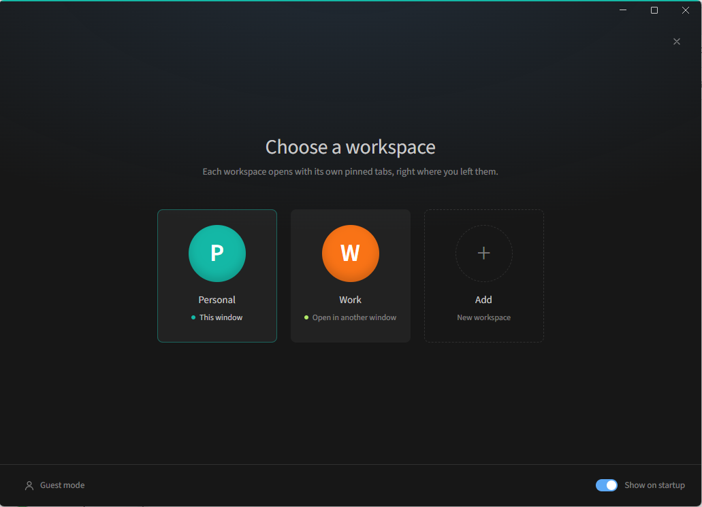
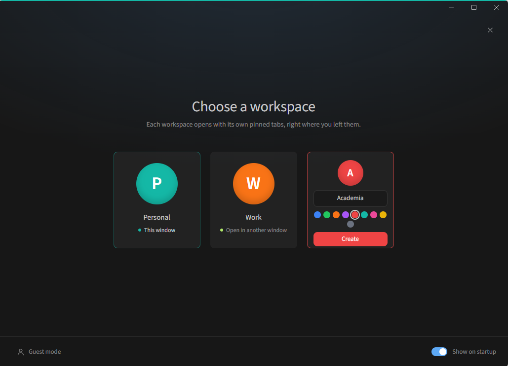
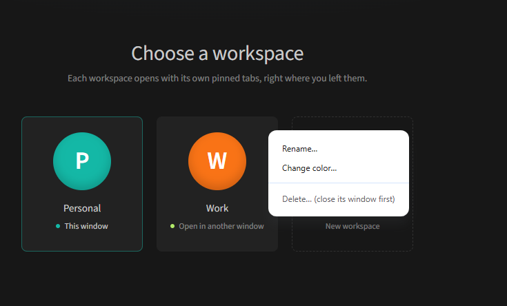
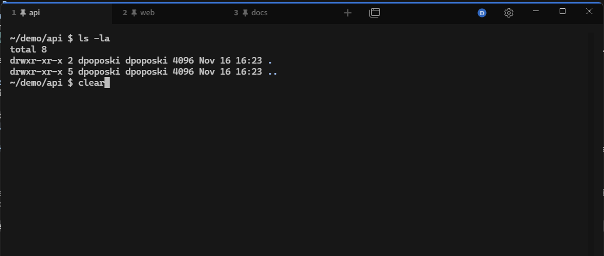
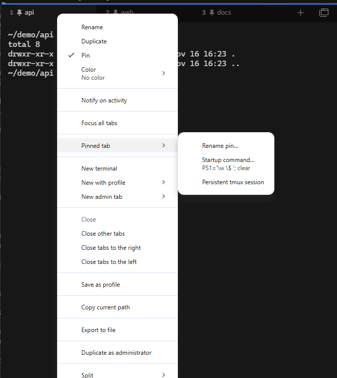
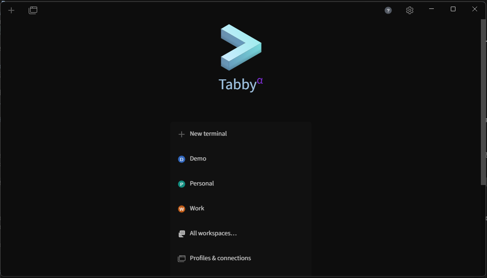
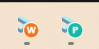
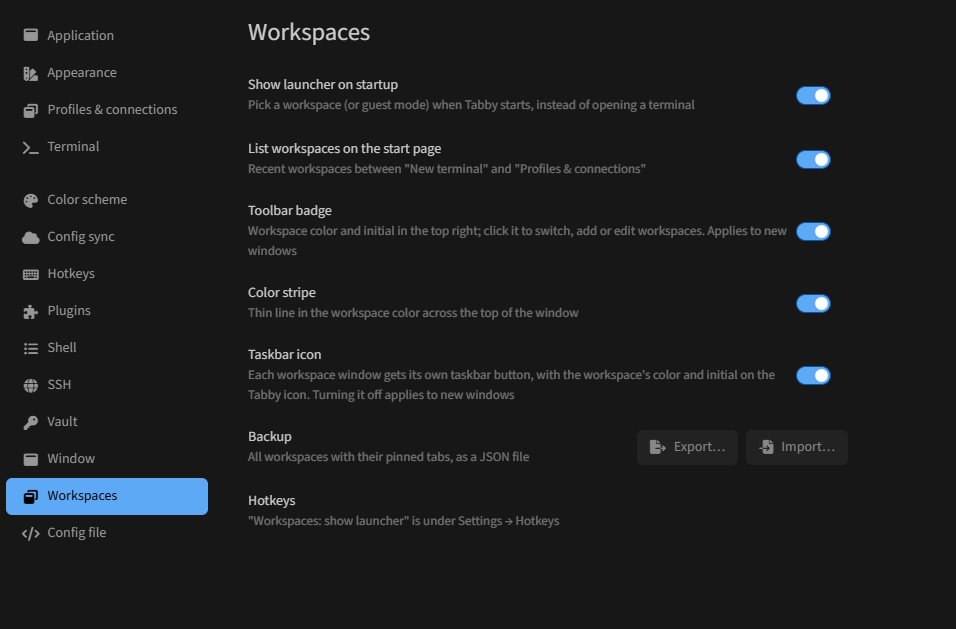

# Tabby Workspaces

Chrome-style workspaces for the [Tabby](https://tabby.sh) terminal. Each workspace gets its own window, and its pinned, named tabs come back every time you open it, in the folder you left them in.

## Features

- **[Startup launcher](#startup-launcher)**: Tabby starts with a list of your workspaces, like Chrome's profile picker
- **[One window per workspace](#one-window-per-workspace)**: a colored badge, stripe and window title show which workspace a window belongs to
- **[Pinned tabs that come back](#pinned-tabs)**: named, with their profile, working directory and an optional startup command
- **[WSL working directory](#wsl-working-directory)**: WSL tabs reopen in the folder you `cd`'d to, without any shell setup
- **[Persistent tmux sessions](#persistent-tmux-sessions)**: a WSL, SSH or macOS/Linux pin can attach to a tmux session that survives closing the window
- **[SSH and serial pins](#ssh-and-serial-pins)**: they reconnect when the workspace opens, and run their startup command once logged in
- **[Workspaces on the start page](#start-page)**: empty windows list your recent workspaces
- **[Own taskbar icon per workspace](#taskbar-icons)**: on Windows, each workspace gets its own taskbar button
- **[Settings page, export and import](#settings)**

### Startup launcher

When Tabby starts, it shows the launcher: one card per workspace, with its color, initial and number of pinned tabs. Click a card or press `1`–`9` to open it; the arrow keys move between cards. A card also shows when you last used the workspace, or that it's open in another window.

- **Add** turns into a small form for a name and a color.
- **Guest mode** opens a plain Tabby window that saves nothing.
- **Show on startup** (bottom right) switches the launcher off, so Tabby starts with a terminal as usual.
- `Esc` closes the launcher.

Hover a card and click **⋯**, or right-click it, to rename it, change its color or delete it. A workspace can only be deleted while no window has it open. If you rename a workspace, launchers open in other windows update right away.

You can open the launcher at any time:
- Click the colored badge in the tab bar.
- Press `Ctrl+Alt+N` (`⌘⌥N` on macOS). Change it under Settings → Hotkeys → "Workspaces: show launcher".
- Run **Workspaces: Show launcher** from the command palette.

### One window per workspace

The window shows which workspace it belongs to in three places:
- a colored badge with the workspace's initial in the tab bar
- a stripe in the workspace's color across the top of the window
- `[workspace name]` at the start of the window title

Picking another workspace from the launcher opens it in a new window. If it's already open somewhere, that window comes to the front instead: a workspace is only ever open in one window, even if two windows try to open it at the same moment.

### Pinned tabs

Right-click a tab and choose **Pin**, or use the `pin-tab` hotkey. You're asked for a name. From then on the tab is part of the workspace. Its profile, working directory, name and startup command are saved as they change, and the tab comes back when you open the workspace again.

Right-click a pinned tab and open **Pinned tab** to:
- rename the pin
- set a **startup command**, which runs each time the tab is restored
- turn on a **persistent tmux session** (WSL, SSH, and shells on macOS and Linux)

Tabs you don't pin last until you close the window, like in Chrome. If you unpin a tab, it stays open but won't come back next time.

### WSL working directory

Tabby can't see where a WSL shell has `cd`'d, because it only controls `wsl.exe`. The plugin fixes this without any change to your shell config. Each WSL shell it starts is tagged with a `TABBY_WORKSPACES_TAB` id (passed in through `WSLENV`). When it saves, it looks that shell's folder up in `/proc`, with one `wsl.exe` call per distro.

### Persistent tmux sessions

This works for WSL tabs, SSH tabs, and local shells (bash, zsh, fish, …) on macOS and Linux. It's off by default; turn on **tmux for new pins** in Settings → Workspaces to make it the default. When it's on, the pin attaches to a tmux session named `tabby-<workspace>-<pin>`. That session keeps running when you close the window, so your programs and scrollback are still there when you reopen the workspace. tmux keeps track of its own panes' folders. For an SSH pin the session runs on the server, so it also survives the connection dropping.

tmux has to be installed where the shell runs: in the distro, on the server, or on your Mac (for example `brew install tmux`). The plugin types the tmux command into the tab's shell, so the shell's own `PATH` finds it.

Switching tmux off, or unpinning the tab and then closing it, ends the session. For SSH, the plugin ends it over the same connection, in a separate channel.

WSL may shut a distro down once all its terminals are closed, and that ends tmux too. If that happens, set `instanceIdleTimeout`/`vmIdleTimeout` in `.wslconfig`.

### SSH and serial pins

SSH, serial and telnet tabs can be pinned like local ones. When the workspace opens they connect again, and the startup command (or tmux) is typed in once the connection is up and the prompt shows. For SSH, the plugin waits up to two minutes for you to log in.

An SSH pin reopens in the folder the remote shell last reported. Tabby only knows that folder if the shell reports it (the OSC 1337 `CurrentDir` sequence). If it doesn't, use tmux, which keeps the folder on the server.

### Start page

An empty Tabby window lists your recent workspaces on the start page, between **New terminal** and **Profiles & connections**. **All workspaces…** opens the launcher.

### Taskbar icons

On Windows and Linux, each workspace window gets the Tabby icon with the workspace's colored initial. On Windows it also gets its own taskbar button, so workspaces aren't all grouped under one Tabby button.

macOS has only one Dock icon per app, so the `[workspace name]` in the window title is what tells windows apart there (in the Window menu, the Dock menu and Mission Control).

### Settings

**Settings → Workspaces**:

| Setting | What it does |
|---|---|
| Show launcher on startup | Off: Tabby starts with a terminal as usual |
| Open the last workspace | Skip the launcher and reopen the workspace you used last (the launcher still shows if it's already open in another window) |
| List workspaces on the start page | Recent workspaces on an empty window's start page |
| Workspaces on the start page | How many it lists, 1–20 (default 8) |
| tmux for new pins | New WSL, SSH and macOS/Linux shell pins get a persistent tmux session, starting the next time the workspace opens |
| Toolbar badge | The colored badge in the tab bar (applies to new windows) |
| Color stripe | The workspace-colored line across the top of the window |
| Taskbar icon | Per-workspace icon and, on Windows, its own taskbar button |
| Export / Import | All workspaces and their pins as one JSON file. Import asks whether to merge them into your workspaces or replace them; workspaces open in a window right now are skipped. |

An export includes the connection profiles of the pinned tabs, so treat the file as private.

## Install

In Tabby, open **Settings → Plugins**, search for **workspaces** and click **Install** on `workspaces`. Then quit Tabby completely and start it again.

Requires Tabby 2.1 or newer (it uses Tabby's pinned tabs).

To uninstall, click **Uninstall** in the same place.

## Good to know

- **Explicit launches skip the launcher.** Command-line launches (`tabby run …`, `tabby open …`) and Tabby's first-run welcome screen work as usual. Opening a tab any other way, for example with a hotkey, closes the launcher.
- **Tabby's own tab restore is paused.** While the plugin is installed, Tabby's "Restore terminal tabs on app start" does nothing, because it only supports one window. Your setting isn't changed and works again if you remove the plugin.
- **Closing the last tab saves.** With "Close the window after closing the last tab" on, closing a workspace's last pinned tab by hand closes the window and leaves the workspace with no pins.
- **Your data is protected:**
  - If stored data can't be read, it's set aside and you get a notification. It's never overwritten.
  - Data written by a newer version of the plugin is opened read-only.
  - An export from a newer version is refused on import.
  - Pinned tabs that can't be restored (for example, their profile was deleted) are kept, and tried again the next time you open the workspace.

## License

[MIT](LICENSE)
